<p align="center">
  <h1 align="center">⚡ RAGNEXUS</h1>
  <p align="center"><strong>Adaptive Knowledge Retrieval and Reasoning System</strong></p>
  <p align="center">
    
    
    
    
    
    
    
    
    
    
  </p>
</p>

---

## 📖 Overview

**RAGNEXUS** is an **Adaptive Knowledge Retrieval and Reasoning System** designed to eliminate hallucinations, handle complex structured documents, dynamically route queries based on intent and metadata, and provide empirical, unbiased retrieval benchmarks.

Standard RAG architectures rely on a single retrieval mechanism (usually naive vector embeddings) that often struggles with exact code identifiers, section hierarchies, or multi-faceted queries. **RAGNEXUS** addresses these challenges through a unified four-phase evolution:

1. **Stabilization & Honest Baseline:** Production-ready ingestion, robust whitespace normalization, and transparent metric evaluation (no fabricated scores).
2. **Structure-Aware PageIndex Retrieval:** Dedicated document structure extraction that navigates outlines, section headings, and explicit page references.
3. **Adaptive LangGraph Workflow:** A stateful, multi-signal reasoning graph that routes queries dynamically (`vector`, `bm25`, `pageindex`, `hybrid`), grades retrieved context relevance, rewrites inadequate queries with a strict retry limit ($\le 2$), and provides safe fallback paths.
4. **Empirical 4-Way Benchmark Suite:** Standardized side-by-side comparison of Vector, BM25, PageIndex, and Hybrid retrieval over identical test queries, measuring latency, chunk volume, and ground-truth lexical overlap.

---

## 🏗️ System Architecture

```mermaid
flowchart TD
    subgraph INGESTION["📄 Ingestion & Indexing Pipeline"]
        A["Uploaded Document<br/>(PDF, DOCX, TXT)"] --> B["File Parser & Text Cleaner"]
        B --> C["Recursive Chunker"]
        C --> D["Dense Embeddings<br/>(FAISS Vector Store)"]
        C --> E["Sparse BM25 Index<br/>(Token Frequency / IDF)"]
        C --> F["PageIndex Extractor<br/>(Headings & Outline Tree)"]
    end

    subgraph WORKFLOW["⚡ Adaptive LangGraph Workflow"]
        Q["User Query"] --> ROUTE["Multi-Signal Router<br/>(Keywords, Cues, Intent)"]
        ROUTE -->|"Dense Concept"| RET_VEC["Vector Retriever"]
        ROUTE -->|"Exact Identifier"| RET_BM25["BM25 Retriever"]
        ROUTE -->|"Section / Page"| RET_PAGE["PageIndex Retriever"]
        ROUTE -->|"Mixed / Broad"| RET_HYB["Hybrid Retriever (RRF)"]
        
        RET_VEC --> GRADE["Grade Context Node<br/>(Relevance Scoring)"]
        RET_BM25 --> GRADE
        RET_PAGE --> GRADE
        RET_HYB --> GRADE

        GRADE -->|"Relevant"| GEN["Generate Answer Node<br/>(Grounded in Citations)"]
        GRADE -->|"Inadequate & Retries < 2"| REWRITE["Rewrite Query Node"]
        GRADE -->|"Exceeded Retries"| FALLBACK["Safe Fallback Node"]
        REWRITE --> ROUTE

        GEN --> VERIFY["Verify Grounding Node"]
        VERIFY --> OUT["Final Answer + Citations + Diagnostics"]
        FALLBACK --> OUT
    end

    subgraph BENCHMARK["🏆 4-Way Retrieval Benchmark"]
        T["Test Cases Dataset"] --> RUNNER["FourWayBenchmarkRunner"]
        RUNNER --> RUN_V["Vector Run"]
        RUNNER --> RUN_B["BM25 Run"]
        RUNNER --> RUN_P["PageIndex Run"]
        RUNNER --> RUN_H["Hybrid Run"]
        RUN_V --> METRICS["Comparative Matrix & Charts<br/>(Latency, Chunks, Overlap)"]
        RUN_B --> METRICS
        RUN_P --> METRICS
        RUN_H --> METRICS
    end
```



---

## ✨ Core Capabilities

| Capability | Module | Description |
|------------|--------|-------------|
| **Structure-Aware PageIndex** | `retrieval/pageindex_retriever.py` | Extracts headings (`1.1`, `#`, `Section`), parses document hierarchies, and targets page-specific cues. |
| **Multi-Signal LangGraph Router** | `workflow/router.py` | Inspects exact quotes/identifiers, structural terms ("page", "section"), and semantic density. |
| **Bounded Self-Correction** | `workflow/nodes.py` | Grades retrieved chunks; if context is inadequate, expands keywords and retries with a strict limit ($\le 2$) to prevent infinite cycles. |
| **Hybrid RRF Fusion** | `retrieval/hybrid_retriever.py` | Fuses dense vector scores with sparse BM25 rankings using Reciprocal Rank Fusion ($k=60$). |
| **4-Way Benchmark Suite** | `evaluation/benchmark_suite.py` | Evaluates Vector, BM25, PageIndex, and Hybrid pipelines under identical top-k parameters with latency and overlap analytics. |
| **Honest RAGAS Integration** | `evaluation/ragas_evaluator.py` | Computes real metrics when dependencies are present; honestly reports `"unavailable"` status when imports or credentials fail—never fabricates mock scores. |
| **Interactive Streamlit UI** | `frontend/` | Premium dark interface with real-time routing badges, diagnostic trace expanders, and Plotly benchmark visualizations. |

---

## 📁 Repository Structure

```
RAG_UPDATE/
├── app.py                          # 🚀 Main Streamlit application entry point
├── requirements.txt                # 📦 Python project dependencies
├── .env.example                    # 🔑 Environment variable template
├── README.md                       # 📖 System documentation
│
├── config/
│   ├── __init__.py
│   └── settings.py                 # ⚙️ Global system defaults (chunk size, models, top_k)
│
├── ingestion/
│   ├── __init__.py                 # 📄 Ingestion package exports
│   ├── file_parser.py              # 📥 Multi-format parser (PDF, DOCX, TXT, string/file-like)
│   ├── text_cleaner.py             # 🧹 Whitespace collapsing & unicode normalization
│   ├── chunker.py                  # ✂️ Recursive character chunking with metadata
│   └── structure_extractor.py      # 📑 Headings, section hierarchies, and page trees
│
├── retrieval/
│   ├── __init__.py                 # 🔍 Retriever package exports
│   ├── semantic_retriever.py       # 🟢 FAISS vector embeddings retriever
│   ├── keyword_retriever.py        # 🔵 BM25 sparse keyword retriever
│   ├── pageindex_retriever.py      # 🟡 Structure-aware PageIndex retriever
│   └── hybrid_retriever.py         # 🟣 Dense + Sparse Reciprocal Rank Fusion (RRF)
│
├── workflow/
│   ├── __init__.py                 # ⚡ LangGraph workflow package exports
│   ├── state.py                    # 🧠 Typed graph state definition (RAGGraphState)
│   ├── router.py                   # 🧭 Multi-signal deterministic query router
│   ├── nodes.py                    # ⚙️ Graph nodes (route, retrieve, grade, rewrite, generate)
│   └── graph.py                    # 🔄 Compiled LangGraph with bounded retries
│
├── llm/
│   ├── __init__.py
│   └── groq_llm.py                 # 🤖 Groq LLM integration (Llama 3.3, 70B, Gemma)
│
├── evaluation/
│   ├── __init__.py
│   ├── ragas_evaluator.py          # 📊 Honest RAGAS evaluation (zero fake metrics)
│   ├── comparison.py               # ⚔️ Direct LLM vs RAG comparison
│   └── benchmark_suite.py          # 🏆 4-Way comparative benchmark engine & exports
│
├── frontend/
│   ├── sidebar.py                  # 📁 File upload & pipeline status panel
│   ├── chat_interface.py           # 💬 Adaptive chat interface with strategy pills & traces
│   ├── evaluation_dashboard.py     # 📊 Evaluation tabs (RAGAS, LLM vs RAG, 4-Way Benchmark)
│   └── metrics_display.py          # 📈 Token & timing metrics cards
│
└── tests/
    ├── test_ingestion.py           # 🧪 Parser, cleaner, and chunker tests
    ├── test_pageindex.py           # 🧪 Structure extractor and PageIndex retriever tests
    ├── test_retrieval.py           # 🧪 Vector, BM25, and Hybrid RRF tests
    ├── test_workflow.py            # 🧪 Multi-signal router and LangGraph state tests
    ├── test_benchmark.py           # 🧪 4-way benchmark runner and export tests
    └── test_evaluation.py          # 🧪 RAGAS error-handling and metric formatting tests
```

---

## 🚀 Setup and Installation

### 1. Prerequisites
- **Python 3.10+**
- A free **Groq API Key** (from [console.groq.com](https://console.groq.com/))

### 2. Environment Setup

```bash
# Clone repository
git clone <repository-url>
cd RAG_UPDATE

# Create and activate virtual environment
python -m venv venv

# Windows (PowerShell)
.\venv\Scripts\Activate.ps1

# Linux / macOS
source venv/bin/activate

# Install dependencies
pip install -r requirements.txt
```

### 3. Configure API Key

Copy the environment template:
```bash
cp .env.example .env
```
Edit `.env` and set your key:
```env
GROQ_API_KEY="gsk_your_groq_api_key_here"
```
*(Alternatively, enter your key interactively in the Streamlit sidebar under Model Settings).*

### 4. Run the Streamlit Application

```bash
streamlit run app.py
```
Open **http://localhost:8501** in your browser.

---

## 🧪 Running the Automated Tests

The entire test suite is designed to run **offline and without mandatory API keys** using fixtures and mocks:

```bash
# Run all tests with verbose output
pytest -v

# Run specific test suites
pytest tests/test_ingestion.py -v
pytest tests/test_pageindex.py -v
pytest tests/test_workflow.py -v
pytest tests/test_benchmark.py -v
```

**Status:** All **78 tests pass cleanly** across ingestion, structure extraction, PageIndex navigation, LangGraph stateful execution, and 4-way benchmarking.

---

## 🔍 Retrieval Strategies & Benchmarking

| Strategy | Engine | Best For | Typical Latency |
|----------|--------|----------|-----------------|
| **1. Vector** | FAISS + Sentence Transformers | Conceptual, semantic, paraphrased questions | ~15–30 ms |
| **2. BM25** | Rank-BM25 | Exact keywords, codes, acronyms, specific terms | ~5–15 ms |
| **3. PageIndex** | StructureExtractor + Outline Tree | Section references, numbered headers, page navigation | ~10–25 ms |
| **4. Hybrid** | Reciprocal Rank Fusion ($k=60$) | Broad, multi-faceted queries requiring semantic + keyword coverage | ~25–50 ms |

### How to Run the 4-Way Benchmark
1. Navigate to the **📊 Evaluation** tab in the UI.
2. Select **🏆 4-Way Retrieval Benchmark**.
3. Upload custom QA JSON or click **"📋 Use Default Suite"**.
4. Click **"🚀 Run 4-Way Benchmark"** to generate side-by-side comparison tables, latency bar charts, ground-truth overlap analytics, and downloadable JSON reports.

---

## 📄 License

This project is licensed under the **MIT License** — see the [LICENSE](LICENSE) file for details.
