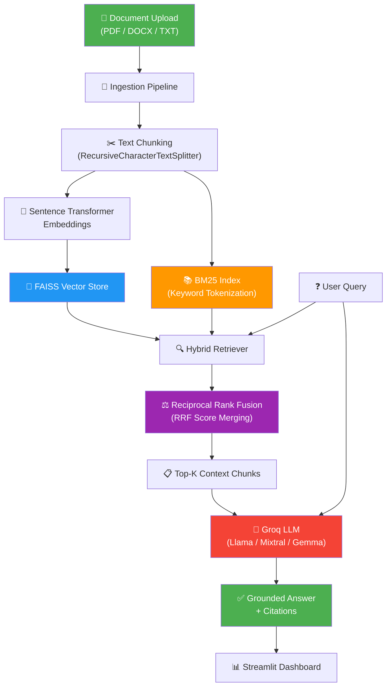

<p align="center">
  <h1 align="center">🧠 Knowledge Copilot</h1>
  <p align="center"><strong>Hybrid RAG Document Intelligence System</strong></p>
  <p align="center">
    
    
    
    
    
    
  </p>
</p>

---

## 📖 Overview

**Knowledge Copilot** is a production-grade **Hybrid Retrieval-Augmented Generation (RAG)** system that lets you upload documents and ask questions grounded in your own data — eliminating LLM hallucinations through citation-aware, context-grounded answers.

### The Problem

Large Language Models (LLMs) are powerful but *hallucinate* — they generate plausible-sounding answers that aren't supported by facts. In knowledge-critical workflows (research, compliance, legal, medical), this is unacceptable.

### The Solution

Knowledge Copilot combines **semantic search** (FAISS vector embeddings) with **keyword search** (BM25) using **Reciprocal Rank Fusion (RRF)** to retrieve the most relevant document chunks, then feeds them to a Groq-powered LLM for grounded, citation-backed answers.

---

## ✨ Key Features

| Feature | Description |
|---------|-------------|
| 📄 **Multi-Format Upload** | PDF, DOCX, and TXT document ingestion |
| 🔍 **Hybrid Retrieval** | Semantic (FAISS) + Keyword (BM25) search with RRF fusion |
| 🤖 **Groq LLM** | Ultra-fast inference via Groq API (Llama, Mixtral, Gemma) |
| 📊 **RAGAS Evaluation** | Faithfulness, Relevancy, Precision, Recall metrics |
| ⚡ **LLM vs RAG Benchmark** | Side-by-side comparison proving RAG reduces hallucinations |
| 🎯 **Citation Tracking** | Every answer shows which document chunks were used |
| 📈 **Interactive Dashboard** | Plotly-powered visualizations in Streamlit |
| 🔧 **Configurable Pipeline** | Tune chunk size, overlap, top-k, embedding model, and more |

---

## 🏗️ Architecture



---

## 🛠️ Tech Stack

| Technology | Purpose |
|-----------|---------|
| **Python 3.10+** | Core language |
| **Streamlit** | Web UI and interactive dashboard |
| **LangChain** | Document processing, chunking, and chain orchestration |
| **FAISS** | Vector similarity search (semantic retrieval) |
| **BM25 (rank-bm25)** | Keyword-based retrieval |
| **Sentence Transformers** | Text embedding model (`all-MiniLM-L6-v2`) |
| **Groq API** | Ultra-fast LLM inference |
| **RAGAS** | RAG evaluation framework |
| **Plotly** | Interactive charts and visualizations |
| **Pandas** | Data manipulation and analysis |
| **PyPDF2 / python-docx** | PDF and DOCX parsing |

---

## 📁 Project Structure

```
RAG_UPDATE/
├── app.py                          # 🚀 Streamlit entry point
├── requirements.txt                # 📦 Python dependencies
├── .env.example                    # 🔑 Environment variable template
├── .gitignore                      # 🙈 Git ignore rules
├── README.md                       # 📖 This file
│
├── config/
│   ├── __init__.py
│   └── settings.py                 # ⚙️ Global configuration constants
│
├── ingestion/
│   ├── __init__.py
│   ├── parser.py                   # 📄 Document parsing (PDF, DOCX, TXT)
│   └── chunker.py                  # ✂️ Text chunking with metadata
│
├── retrieval/
│   ├── __init__.py
│   └── hybrid_retriever.py         # 🔍 FAISS + BM25 + RRF fusion
│
├── llm/
│   ├── __init__.py
│   └── groq_llm.py                 # 🤖 Groq LLM integration
│
├── evaluation/
│   ├── __init__.py
│   ├── ragas_evaluator.py          # 📊 RAGAS metrics computation
│   └── comparison.py               # ⚡ LLM vs RAG benchmarking
│
├── data/
│   ├── .gitkeep
│   └── sample/
│       └── sample_qa.json          # 📝 Sample evaluation questions
│
├── vector_store/
│   └── .gitkeep                    # 💾 FAISS index storage
│
└── tests/
    ├── __init__.py
    ├── test_ingestion.py           # 🧪 Ingestion pipeline tests
    ├── test_retrieval.py           # 🧪 Retrieval & RRF tests
    └── test_evaluation.py          # 🧪 Evaluation module tests
```

---

## 🚀 Installation

### Prerequisites

- Python 3.10 or higher
- A free [Groq API key](https://console.groq.com/)

### Step-by-Step Setup

```bash
# 1. Clone the repository
git clone https://github.com/yourusername/knowledge-copilot.git
cd knowledge-copilot

# 2. Create and activate a virtual environment
python -m venv venv

# Windows
venv\Scripts\activate

# macOS/Linux
source venv/bin/activate

# 3. Install dependencies
pip install -r requirements.txt

# 4. Set up environment variables
cp .env.example .env
# Edit .env and add your Groq API key

# 5. Launch the application
streamlit run app.py
```

The app will open at **http://localhost:8501** 🎉

---

## 📘 Usage Guide

### 1. Upload Documents

- Click **"Upload Documents"** in the sidebar
- Supported formats: **PDF**, **DOCX**, **TXT**
- Documents are automatically parsed, chunked, and indexed

### 2. Ask Questions

- Type your question in the chat input
- The system retrieves relevant chunks using hybrid search
- The LLM generates a grounded answer with citations

### 3. View Citations

- Each answer shows the source chunks that were used
- Chunk metadata includes: source file, page number, chunk index

### 4. Run Evaluation

- Navigate to the **Evaluation** tab
- Run RAGAS metrics on your Q&A pairs
- Compare LLM-only vs Hybrid RAG performance

---

## 🔍 Hybrid Retrieval Explained

Knowledge Copilot uses a **hybrid retrieval** strategy that combines two complementary search approaches:

### Semantic Search (FAISS)

Embeds queries and documents into dense vector space using Sentence Transformers. Captures **meaning and intent** — e.g., "automobile" matches "car".

### Keyword Search (BM25)

Uses term frequency–inverse document frequency (TF-IDF) scoring. Excels at **exact term matching** — e.g., specific names, codes, acronyms.

### Reciprocal Rank Fusion (RRF)

Merges results from both retrievers using the RRF formula:

$$\text{RRF}(d) = \sum_{r \in \text{Retrievers}} \frac{1}{k + \text{rank}_r(d)}$$

Where:
- $d$ is a document chunk
- $r$ iterates over each retriever (semantic, BM25)
- $\text{rank}_r(d)$ is the rank of document $d$ in retriever $r$
- $k = 60$ is a smoothing constant

Documents found by **both** retrievers get higher fused scores, ensuring the most relevant chunks surface to the top.

---

## 📊 Evaluation Methodology

We use [RAGAS](https://docs.ragas.io/) (Retrieval Augmented Generation Assessment) to evaluate the pipeline with four metrics:

| Metric | What It Measures | Good Score |
|--------|-----------------|------------|
| **Faithfulness** | Is the answer factually consistent with the retrieved context? | > 0.8 |
| **Answer Relevancy** | Is the answer relevant to the question asked? | > 0.8 |
| **Context Precision** | Are the retrieved chunks actually relevant (signal vs noise)? | > 0.7 |
| **Context Recall** | Does the retrieved context cover all parts of the ground truth? | > 0.7 |

---

## ⚡ LLM vs Hybrid RAG — Why RAG Wins

| Aspect | Direct LLM | Hybrid RAG |
|--------|-----------|------------|
| **Hallucination Risk** | ❌ High – generates from training data | ✅ Low – grounded in your documents |
| **Factual Accuracy** | Variable | High (verified against source) |
| **Source Attribution** | ❌ None | ✅ Chunk-level citations |
| **Domain Specificity** | Generic knowledge | Your uploaded documents |
| **Up-to-Date Info** | Training cutoff | Real-time from your files |

The evaluation dashboard lets you **quantify** this difference with RAGAS scores, showing exactly how much RAG improves faithfulness and relevancy over a bare LLM.

---

## ☁️ Deployment (Streamlit Cloud)

### Deploy in 4 Steps

1. **Push to GitHub**
   ```bash
   git init
   git add .
   git commit -m "Initial commit - Knowledge Copilot"
   git remote add origin https://github.com/yourusername/knowledge-copilot.git
   git push -u origin main
   ```

2. **Connect to Streamlit Cloud**
   - Go to [share.streamlit.io](https://share.streamlit.io)
   - Click **"New app"** → select your repository

3. **Add Secrets**
   - In the Streamlit Cloud dashboard, go to **Settings → Secrets**
   - Add:
     ```toml
     GROQ_API_KEY = "your_groq_api_key_here"
     ```

4. **Deploy** — Your app is live! 🚀

---

## ⚙️ Configuration

All parameters are configurable in `config/settings.py`:

| Parameter | Default | Description |
|-----------|---------|-------------|
| `CHUNK_SIZE` | `1000` | Maximum characters per text chunk |
| `CHUNK_OVERLAP` | `200` | Overlap between consecutive chunks |
| `EMBEDDING_MODEL` | `all-MiniLM-L6-v2` | Sentence Transformer model for embeddings |
| `TOP_K_SEMANTIC` | `5` | Number of FAISS results to retrieve |
| `TOP_K_BM25` | `5` | Number of BM25 results to retrieve |
| `RRF_K` | `60` | RRF smoothing constant |
| `LLM_MODEL` | `llama3-8b-8192` | Groq model for answer generation |
| `LLM_TEMPERATURE` | `0.1` | LLM temperature (lower = more deterministic) |
| `MAX_TOKENS` | `1024` | Maximum tokens in LLM response |

---

## 📄 License

This project is licensed under the **MIT License** — see the [LICENSE](LICENSE) file for details.

```
MIT License

Copyright (c) 2024 Knowledge Copilot

Permission is hereby granted, free of charge, to any person obtaining a copy
of this software and associated documentation files (the "Software"), to deal
in the Software without restriction, including without limitation the rights
to use, copy, modify, merge, publish, distribute, sublicense, and/or sell
copies of the Software, and to permit persons to whom the Software is
furnished to do so, subject to the following conditions:

The above copyright notice and this permission notice shall be included in all
copies or substantial portions of the Software.

THE SOFTWARE IS PROVIDED "AS IS", WITHOUT WARRANTY OF ANY KIND, EXPRESS OR
IMPLIED, INCLUDING BUT NOT LIMITED TO THE WARRANTIES OF MERCHANTABILITY,
FITNESS FOR A PARTICULAR PURPOSE AND NONINFRINGEMENT. IN NO EVENT SHALL THE
AUTHORS OR COPYRIGHT HOLDERS BE LIABLE FOR ANY CLAIM, DAMAGES OR OTHER
LIABILITY, WHETHER IN AN ACTION OF CONTRACT, TORT OR OTHERWISE, ARISING FROM,
OUT OF OR IN CONNECTION WITH THE SOFTWARE OR THE USE OR OTHER DEALINGS IN THE
SOFTWARE.
```

---

## 🙏 Acknowledgments

- [LangChain](https://www.langchain.com/) — Document processing and chain orchestration
- [FAISS](https://github.com/facebookresearch/faiss) — Efficient similarity search by Meta AI
- [RAGAS](https://docs.ragas.io/) — RAG evaluation framework
- [Groq](https://groq.com/) — Lightning-fast LLM inference
- [Streamlit](https://streamlit.io/) — Beautiful data apps in minutes
- [Sentence Transformers](https://www.sbert.net/) — State-of-the-art text embeddings
- [rank-bm25](https://github.com/dorianbrown/rank_bm25) — BM25 implementation in Python
- [Plotly](https://plotly.com/) — Interactive visualizations

---

<p align="center">
  Made with ❤️ for smarter, hallucination-free document intelligence.
</p>
